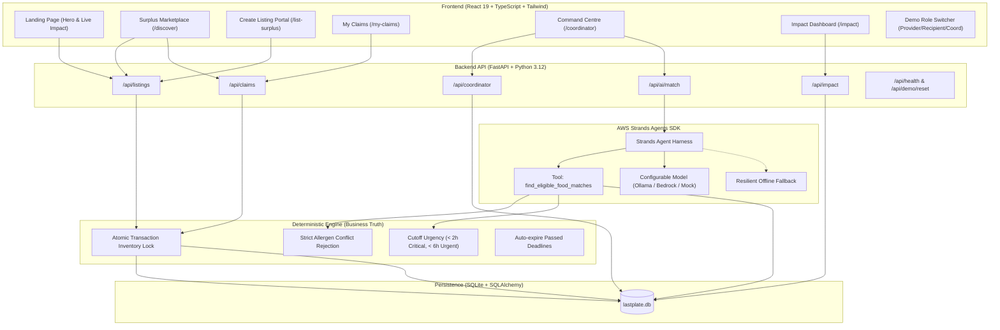

# LastPlate — Good food. A second chance.

> **Environmental Hacks · Bharat Builds Tour**  
> **Track:** Waste and Energy  
> **Open-Source Requirement:** AWS Strands Agents SDK (`strands-agents`)  
> **Status:** Fully Functional Local MVP with Deterministic AI Grounding

---

## 1. Problem Statement & Core Promise

Across college canteens, artisan bakeries, corporate cafeterias, and neighborhood grocery stores, nutritious, perfectly edible food is discarded daily simply because it reached the end of an evening shift or sales window. At the same time, nearby student hostels, community kitchens, and relief organizations often struggle with food costs and supply constraints.

Existing surplus distribution methods fail due to:
1. **Time perishability:** Surplus food has a strict 2-to-6 hour pickup window before it spoils or gets tossed.
2. **Allergen risks:** Language models hallucinating food safety or guessing allergens can cause severe allergic emergencies.
3. **Logistical coordination friction:** Lack of transparent inventory locks, pickup codes, and verifiable handovers.

### Core Product Promise
> **"Good food. A second chance."**  
> LastPlate connects surplus food providers with eligible recipients before the food's pickup deadline expires.

---

## 2. Architecture & AWS Open-Source Integration

LastPlate combines a reactive **FastAPI + SQLite** backend, a modern **React + Vite + Tailwind CSS** frontend, and the official **AWS Strands Agents SDK** (`strands-agents`) for AI-assisted surplus distribution planning.

### Architecture Diagram



---

## 3. How AWS Strands Agents SDK is Used

LastPlate integrates the official AWS open-source **Strands Agents SDK** (`strands-agents`, version `1.59.0`):

1. **Agent Tool Registration:**  
   The application defines and registers a real Python tool decorated with `@tool`:
   ```python
   from strands import Agent, tool

   @tool
   def find_eligible_food_matches(listing_id: str = "") -> str:
       """Query current inventory and find eligible matches based on strict deterministic rules."""
       ...
   ```
2. **Strict Deterministic Grounding:**  
   The agent **never hallucinates allergen safety or invents food**. The underlying tool enforces:
   - Hard allergen conflict rejection (if recipient avoids Peanuts and listing contains Peanuts, it is strictly excluded).
   - Non-expired, active listings check (`pickup_deadline > now`).
   - Available portion capacity and recipient dietary match.
   - Urgency bonus score for listings expiring within 2 to 6 hours.
3. **Multi-Model & Offline Resilience:**  
   - Compatible with local Ollama (`llama3.2`), AWS Bedrock, OpenAI, or deterministic mock.
   - If an external model provider is unreachable or unconfigured, LastPlate executes deterministic matching and returns an expert structured response with `ai_status: "offline_fallback"`. The marketplace and claims workflow **never halt**.

---

## 4. Key User Roles & Pages

LastPlate includes a top-bar **Demo Role Switcher** with three pre-seeded personas:

### 1. Food Provider (`usr-provider-1`: Campus Central Canteen)
- **`/list-surplus`**: Publish surplus food with live card preview, preset photos, preparation timestamp, pickup deadline, storage temperatures, and declared allergens.
- View real-time portion reservations and confirmed handovers.

### 2. Recipient (`usr-recipient-1`: Hostel 4 Food Committee)
- **`/discover`**: Search and filter by category (Prepared Meals, Bakery, Produce, Packaged Goods) and dietary compatibility (Vegetarian, Vegan, Halal, Gluten-Free).
- Select portions and reserve in 1 click.
- **`/my-claims`**: View upcoming collections, unique pickup code (`LP-XXX-XXXX`), collection point, cancellation, and handover confirmation.

### 3. Coordinator (`usr-coord-1`: Maya Sharma)
- **`/coordinator`**: Distribution Command Centre monitoring critical deadlines, active surplus, pending collections, and auto-expired listings.
- **AI Priority Dispatch Panel**: Run Strands Agent to evaluate pairing suggestions, review grounded evidence, inspect allergen test results, and approve fast-track dispatches with coordinator override.

### 4. Environmental Impact Ledger (`/impact`)
- **Strict Distinction:** Only *confirmed completed handovers* count toward rescued food impact figures (never listed or cancelled food).
- **Interactive Recharts Visualizations:** Daily rescue timeseries and category breakdown.
- **Defensible Methodology:** Standardized at 0.45 kg per portion and 2.5 kg CO₂e avoided per kg food rescued (FAO benchmark).

### 5. Methodology & Trust (`/how-it-works`)
- Comprehensive documentation of safety protocols, allergen policies, and calculation models.

---

## 5. Technology Stack

- **Frontend:** React 19, TypeScript, Vite, Tailwind CSS v4, Lucide React, Recharts, Motion, Canvas-Confetti.
- **Backend:** Python 3.12, FastAPI, SQLAlchemy 2.0, Pydantic v2, Uvicorn, SQLite.
- **AI Agent Framework:** AWS Strands Agents SDK (`strands-agents`).
- **Testing:** Pytest, Vite Build typechecker (`tsc -b`).

---

## 6. Local Setup and Installation

### Prerequisites
- Node.js 18+ and npm
- Python 3.10+ (tested on Python 3.12)

### Backend Setup

1. Open a terminal in the `backend/` directory:
   ```bash
   cd backend
   ```
2. Create and activate a Python virtual environment:
   ```bash
   # Windows PowerShell
   python -m venv .venv
   .venv\Scripts\activate

   # macOS / Linux
   python3 -m venv .venv
   source .venv/bin/activate
   ```
3. Install dependencies:
   ```bash
   pip install -r requirements.txt
   ```
4. Copy the environment variables:
   ```bash
   cp .env.example .env
   ```
5. Seed the database with realistic demonstration data:
   ```bash
   python seed.py
   ```
6. Start the FastAPI server:
   ```bash
   python -m uvicorn app.main:app --host 127.0.0.1 --port 8000 --reload
   ```
   API Docs available at: `http://127.0.0.1:8000/docs`

### Frontend Setup

1. In a separate terminal, navigate to `frontend/`:
   ```bash
   cd frontend
   ```
2. Install Node dependencies:
   ```bash
   npm install
   ```
3. Start the Vite development server:
   ```bash
   npm run dev
   ```
4. Open `http://localhost:5173` in your browser.

---

## 7. Running Tests & Quality Verification

Run backend test suite covering business rules, inventory locks, cancellations, pickup confirmations, impact calculation, and AI matching:
```bash
cd backend
.venv\Scripts\pytest tests/test_api.py -v
```
*Result: 7 passed tests covering all critical business rules.*

Test frontend production build:
```bash
cd frontend
npm run build
```
*Result: Clean TypeScript compilation and optimized production bundle.*

---

## 8. Predictable 3-Minute Hackathon Demo Script

| Time | Screen / Action | Presentation Talking Points |
| :--- | :--- | :--- |
| **0:00–0:25** | **Landing Page (`/`)** | Introduce problem: Good food wasted daily in campus canteens and bakeries while student communities face food insecurity. Highlight live impact counters and the core promise: *"Good food. A second chance."* |
| **0:25–0:55** | **List Surplus (`/list-surplus`)** | Switch role to *Food Provider*. Create a surplus listing: *18 portions of Vegetable Rice Bowls*, set pickup deadline to 2.5 hours, select declared allergens (*Dairy*), and view live preview before publishing. |
| **0:55–1:25** | **Command Centre (`/coordinator`)** | Switch role to *Coordinator*. Inspect the AI Distribution Panel powered by **AWS Strands Agents SDK**. The agent calls `find_eligible_food_matches`, highlights urgent deadlines, verifies allergen safety, and provides grounded evidence. Show 1-click coordinator dispatch. |
| **1:25–1:55** | **Marketplace (`/discover`) & Claims (`/my-claims`)** | Switch role to *Recipient*. Filter by *Prepared Meals* and *Vegetarian*. Open listing modal, select portions, and confirm claim with confetti animation. Show claim reference code (`LP-XXX-XXXX`) in `/my-claims`. |
| **1:55–2:20** | **Pickup Confirmation** | In `/my-claims`, click **"Confirm Handover Collection"**. The claim transitions to *Confirmed* and inventory status updates atomically. |
| **2:20–2:45** | **Impact Ledger (`/impact`)** | Show the impact dashboard updating in real-time. Emphasize that *only confirmed collections count toward impact totals*, using documented assumptions (0.45 kg/portion and 2.5 kg CO₂e). |
| **2:45–3:00** | **Technology & Wrap-up** | Summarize: React frontend, FastAPI backend, SQLite persistence, and AWS Strands Agents SDK running locally without paid cloud lock-in. |

---

## 9. License & Attributions

- Built for **Environmental Hacks (Bharat Builds Tour)** under the **Waste and Energy** track.
- Powered by the open-source **AWS Strands Agents SDK** (`strands-agents`).
- Photography curated from [Unsplash](https://unsplash.com) under the Unsplash free license for demo purposes.
- Standard food-waste methodology benchmarks from the [UN Food and Agriculture Organization (FAO)](https://www.fao.org).
